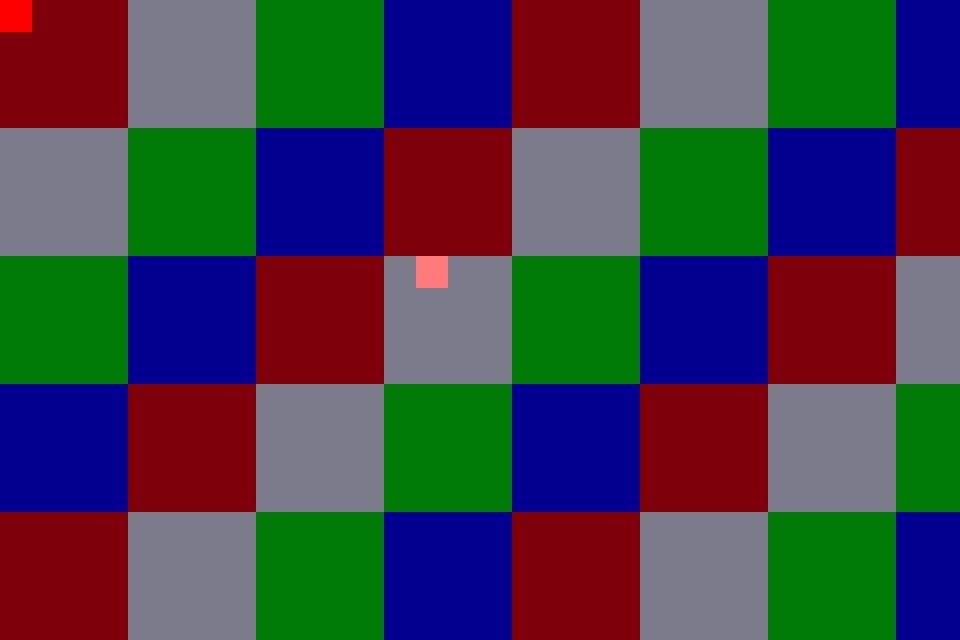
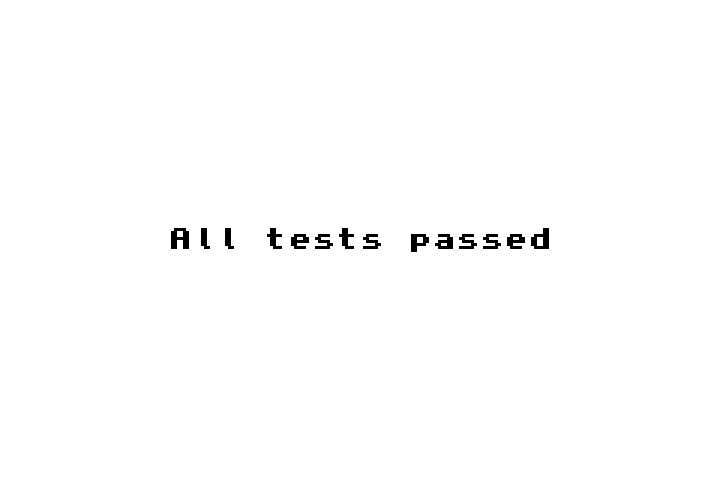
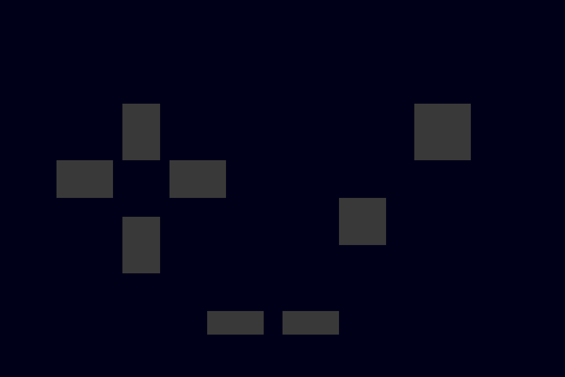

# Cinnabar

**A clean-room Game Boy Advance emulator in Rust.**

Cinnabar is split into a headless, deterministic emulator core and a small native
frontend. It boots real GBA ROMs, runs the full ARM and Thumb instruction sets,
renders modes 0–5, plays PSG and DMA sound, and persists SRAM/Flash saves. No
Nintendo BIOS image is required: the common BIOS SWI calls are implemented as
HLE.


| Tiled mode + sprite + alpha blending | Full ARM test suite |
|---|---|
|  |  |

## The highlights

- **ARM7TDMI interpreter** with ARM and Thumb, banked registers, exceptions, and
  the ARM7TDMI pipeline quirks that real test ROMs care about.
- **Passes the full `gba-tests` ARM and Thumb suites**, plus the memory, SRAM,
  Flash 64K, and Flash 128K suites.
- **Scanline PPU** with modes 0–5, text and affine backgrounds, sprites,
  windows, alpha blending, and brightness effects.
- **Audio** with the four GB channels (square, wave, noise), envelopes, sweep,
  frame sequencer, and DMA sound A/B, mixed to 48 kHz stereo.
- **DMA, timers, interrupts, keypad, cartridge saves**, and a BIOS HLE for
  decompression, CpuSet/CpuFastSet, division, square root, affine setup, and
  interrupt waits.
- **Native frontend** using `winit`, `softbuffer`, and `cpal`: integer-scaled
  video, audio, keyboard input, pause, fast-forward, screenshots, and save
  persistence.
- **Headless mode** for CI and screenshots: no window, no audio device, just
  frames in and a PNG out.

## Quick start

Cinnabar needs a stable Rust toolchain (1.85+) and the usual Linux window/audio
development libraries. On Arch:

```bash
sudo pacman -S rustup alsa-lib wayland libxkbcommon
rustup default stable
```

On Debian/Ubuntu:

```bash
sudo apt install build-essential pkg-config libasound2-dev \
  libwayland-dev libxkbcommon-dev libx11-dev libxkbcommon-x11-dev
```

Then:

```bash
cargo run -p cinnabar-frontend -- --selftest
cargo run -p cinnabar-frontend -- --list-builtins
cargo run -p cinnabar-frontend -- --demo
```

`--selftest` needs no ROM and no window. `--demo` runs the bundled logo. To play
a ROM you own:

```bash
cargo run -p cinnabar-frontend -- /path/to/game.gba
```

Build a release binary:

```bash
cargo build --release -p cinnabar-frontend
./target/release/cinnabar /path/to/game.gba
```

Headless screenshot:

```bash
cargo run -p cinnabar-frontend -- /path/to/game.gba \
  --headless --frames 600 --screenshot shot.png
```

Inspect a cartridge without running it:

```bash
cargo run -p cinnabar-frontend -- /path/to/game.gba --info
```

### Controls

| Key | GBA |
|---|---|
| `Z` | A |
| `X` | B |
| `Enter` | Start |
| `Backspace` | Select |
| Arrow keys | D-pad |
| `A` | L |
| `S` | R |
| `Esc` | Quit |
| `F1` | Pause |
| `F2` | Fast-forward |
| `F5` | Screenshot to `screenshots/` |
| `F11` | Fullscreen |

Saves are written next to the ROM as `<rom>.sav` (or to `--save <path>`), and
loaded automatically on the next run.

## Manual testing without a ROM

Cinnabar ships with test cartridges, so you do not need a commercial ROM to
check that the emulator works.

### 1. The one-command check

```bash
cargo run -p cinnabar-frontend -- --selftest
```

```text
Cinnabar self-test
  [ok]   logo demo: 3 colors, red C on dark blue
  [ok]   tiled PPU: 6 colors, blended sprite
  [ok]   keypad: A, right and Start indicators
  [ok]   DMA + IRQ: 8 VBlank, 34 timer IRQs
  [ok]   VBlankIntrWait: 8 wake-ups
  [ok]   mode 3 gradient: 38400 colors
all 6 checks passed
```

This exercises the CPU, PPU, keypad, DMA, timers, IRQs, `VBlankIntrWait`, and
the bundled ROMs without opening a window.

### 2. Check the keyboard

```bash
cargo run -p cinnabar-frontend -- --builtin input
```



The left cross is the D-pad, the boxes on the right are A and B, and the two
small bars at the bottom are Start and Select. Hold a key and the matching box
turns green, red, or white. If nothing lights up, click the window to focus it,
then try again.

### 3. Check tiled rendering and sprite blending

```bash
cargo run -p cinnabar-frontend -- --builtin tiled
```

You should see a checkerboard of red, white, green, and blue 32×32 blocks, plus
a pink 8×8 sprite near the center that is alpha-blended over the tile below it.

### 4. Run open-source test ROMs

```bash
./tools/fetch-test-roms.sh
cargo run -p cinnabar-frontend -- test-roms/gba-tests/ppu/hello.gba
cargo run -p cinnabar-frontend -- test-roms/gba-tests/arm/arm.gba
```

The first should show `Hello world!`; the second should show
`All tests passed`.

### 5. Play a real homebrew game

Celeste Classic is a third-party GBA port with a public release. Cinnabar does
not bundle it; fetch it from the upstream project:

```bash
./tools/fetch-celeste.sh
cargo run -p cinnabar-frontend -- test-roms/homebrew/celeste.gba
```

Expected: the Celeste title screen, then gameplay after pressing Z or Enter.

| Key | Action |
|---|---|
| Arrow keys | Move |
| `Z` | Jump |
| `X` | Dash |
| `Enter` | Pause |
| `Backspace` | Toggle screen shake |

### 6. Try your own ROM

Drag a `.gba` file onto the Cinnabar window, or pass it on the command line.
The window title and save path update when a ROM is dropped.

### Built-in cartridges

```bash
cargo run -p cinnabar-frontend -- --list-builtins
```

| Name | What it shows |
|---|---|
| `logo` | Red Cinnabar C on a dark blue field |
| `tiled` | Mode 0 tiles, a sprite, and alpha blending |
| `input` | Keypad test screen |
| `irq` | DMA3 fill + timer and VBlank interrupts |
| `halt` | `VBlankIntrWait` halt/wake |
| `gradient` | Mode 3 color test pattern |

`--demo` is shorthand for `--builtin logo`. Any built-in works headless:

```bash
cargo run -p cinnabar-frontend -- --builtin tiled \
  --headless --frames 3 --screenshot tiled.png
```

### If something does not work

- **"no ROM given"**: use `--demo`, `--builtin <name>`, or `--selftest`.
- **No window**: run `--selftest` or `--headless` to confirm the core works,
  then check that `WAYLAND_DISPLAY` or `DISPLAY` is set in your graphical
  session.
- **No audio**: Cinnabar prints a warning and keeps running silently.
- **Window too small**: start with `--scale 4`.
- **Slow**: build a release binary with `cargo run --release -p cinnabar-frontend`.
- **Keyboard does nothing**: click the window to focus it and try
  `--builtin input`.

## Architecture

```text
crates/
├── cinnabar-core/       headless emulator; no window, audio device, or filesystem
│   ├── cpu/             ARM7TDMI: ARM, Thumb, banked registers, exceptions
│   ├── bus.rs           memory map, I/O dispatch, DMA and event stepping
│   ├── ppu.rs           scanline renderer, modes 0–5, sprites, windows, blending
│   ├── apu.rs           PSG + DMA sound, 48 kHz stereo mixer
│   ├── cart.rs          header parsing and ROM mirroring
│   ├── save.rs          SRAM and AMD-style Flash, 8-bit bus semantics
│   ├── bios.rs          HLE SWI implementations
│   └── system.rs        CPU + bus + frame loop
├── cinnabar-frontend/   winit + softbuffer + cpal + clap binary
└── cinnabar-testrom/    hand-written demo ROMs and their assembly
```

The core is deliberately I/O-free. `System::run_frame()` returns a
`FrameOutput` containing a 240×160 BGR555 framebuffer and interleaved stereo
audio. That makes the emulator testable in CI without a display or sound card.

The PPU renders one scanline at a time. The CPU advances the bus in cycle
chunks, and the bus steps timers, audio, the PPU, and DMA together. The frontend
owns the window, audio device, frame pacing, and save files.

## Validation

The emulator is checked against the open-source
[`jsmolka/gba-tests`](https://github.com/jsmolka/gba-tests) suite:

```bash
./tools/validate.sh
```

```text
PASS arm                r12=00000000
PASS thumb              r7=00000000
PASS memory             r12=00000000
PASS sram               r12=00000000
PASS flash64            r12=00000000
PASS flash128           r12=00000000
PASS none               r12=00000000
PASS hello              colors=2
PASS shades             colors=15
PASS stripes            colors=2
PASS celeste            colors=11 non_black=11995 audio_peak=0.5000
all selected validations passed
```

| Suite | Status |
|---|---|
| ARM instructions | **PASS** (all tests) |
| Thumb instructions | **PASS** (all tests) |
| Memory mirrors | **PASS** |
| SRAM saves | **PASS** |
| Flash 64K | **PASS** |
| Flash 128K / bank switching | **PASS** |
| PPU hello / shades / stripes | **PASS** (visual) |
| Mode 0 tiles + sprite + alpha blending | **PASS** (demo + integration test) |
| DMA + timer/VBlank IRQ | **PASS** (integration test) |
| VBlankIntrWait / halt-wake | **PASS** (integration test) |
| Keypad test screen | **PASS** (integration test + `--builtin input`) |
| Celeste Classic title + gameplay | **PASS** (optional real-game smoke test) |
| BIOS internals | Not applicable: Cinnabar uses HLE instead of a real BIOS |
| EEPROM saves | Not implemented |
| `unsafe` suite | Test 2 is documented upstream as failing on real hardware; it is not part of our validation |

The workspace test suite covers CPU decoding, flags, exceptions, PPU mode 3, APU
synthesis, frontend video/audio conversion, CLI, save storage, and the demo
cartridge integration test:

```bash
cargo test --workspace
```

### Reproducing the test ROMs

```bash
./tools/fetch-test-roms.sh   # clones gba-tests into test-roms/ (gitignored)
./tools/validate.sh          # runs the selected suites and PPU demos
```

### Rebuilding the demo ROMs

The demo ROMs are hand-written ARM assembly:

```bash
./tools/build-demo-rom.sh    # requires llvm-mc, llvm-objcopy, python3
```

Source lives in `crates/cinnabar-testrom/roms/`.

## Performance

Cinnabar is headless-first, and the core is fast. On this machine, a 300-frame
Celeste Classic gameplay run (A held to start) finishes in about 0.66 seconds,
or ~455 fps:

```text
frames=300 elapsed=0.659s fps=455.0
```

The frontend is paced at the GBA's 59.7275 Hz, so it has roughly 7–8× headroom.
The release profile uses fat LTO, one codegen unit, and abort panics.

Benchmark it yourself:

```bash
./tools/fetch-celeste.sh
make bench
```

Or directly:

```bash
cargo run --release -p cinnabar-core --example bench -- \
  test-roms/homebrew/celeste.gba 300 1
```

The trailing `1` is the keypad mask for A, which starts the game. Omit it for a
title-screen benchmark. Numbers vary by machine; for local maximum performance,
try `RUSTFLAGS="-C target-cpu=native" make bench`.

The main optimizations are:

- A per-scanline sprite cache instead of scanning all 128 OAM entries per pixel.
- 32-cycle peripheral batching instead of four function calls per CPU
  instruction.
- Fat LTO and `codegen-units = 1`.
- A headless core with no windowing or audio dependencies.

## Development

```bash
cargo fmt --all
cargo clippy --workspace --all-targets -- -D warnings
cargo test --workspace
```

Or use the `Makefile`:

```bash
make test
make lint
make validate
make selftest
make input
make celeste
make bench
make demo
```

## What works, and what is next

Cinnabar is a real emulator, not a tech demo, but no emulator is ever finished.
The honest compatibility picture:

**Working**

- ARM and Thumb instruction sets, banked registers, mode changes, exceptions.
- Memory map, mirrors, cartridge ROM access, SRAM/Flash saves.
- PPU modes 0–5, text/affine backgrounds, sprites, windows, alpha and brightness
  effects.
- PSG channels, DMA sound, frame sequencer, stereo mixer.
- DMA, timers, IRQ controller, keypad, BIOS HLE including `Halt` and
  `VBlankIntrWait`.
- Windowed frontend, audio, headless screenshots, save persistence.

**Known limitations**

- BIOS internals are HLE, not a cycle-accurate BIOS. The `bios` test ROM is not
  supported by design.
- EEPROM saves are not implemented yet.
- Audio DMA timing is approximated, and high square/noise frequencies alias at
  48 kHz.
- Mosaic and a few PPU edge cases are register-complete but not fully rendered.
- No save states, debugger, link cable, netplay, or shaders yet.
- Commercial game compatibility is still a work in progress. The CPU, memory,
  and save foundations are validated; PPU edge cases and timing are the next
  compatibility frontier.

See [`ROADMAP.md`](ROADMAP.md) for the next milestones.

## Legal

Cinnabar contains **no Nintendo ROMs and no Nintendo BIOS**. The demo cartridges
are generated from the assembly in this repository. You must supply your own
legally dumped ROMs and BIOS if you want to use them. `gba-tests` is fetched
separately and remains under its own license.

Game Boy Advance is a trademark of Nintendo. Cinnabar is not affiliated with or
endorsed by Nintendo.

## Credits

- [`jsmolka/gba-tests`](https://github.com/jsmolka/gba-tests) for the test ROMs
  that keep the CPU honest.
- GBATEK, TONC, and Pan Docs for the hardware documentation.
- mGBA and NanoBoyAdvance as reference implementations and debugging companions.
- The Rust ecosystem: `winit`, `softbuffer`, `cpal`, `clap`, `rtrb`, and `image`.

## License

MIT. See [`LICENSE`](LICENSE).
